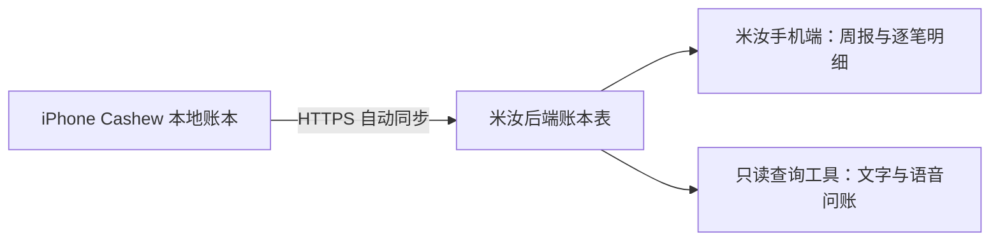

# Cashew → 米汝账本接入方案

日期：2026-10-13；实施更新：2026-10-14。状态：服务端、Miru 账本页和 Cashew iOS 上传模块已实现并通过本地检查，正在准备构建与部署。实际手机安装和首次配对仍待验证。

## 1. 目标与结论

继续在 iPhone 侧载的 Cashew 记账；Cashew 自动向现有米汝后端上传账本副本。米汝手机端显示每条明细、本周收入支出、分类统计，也支持文字和语音查询。第一版由 Cashew 单向提供数据，米汝只读；账单修改、删除仍在 Cashew 完成。

复用现有米汝云服务和数据库备份体系，不需要先购买新的数据库服务。新增负载须在上线前以实际账单量验证。Cashew 不依赖家中 Windows 节点同步；手机需要能访问现有米汝地址，如果继续使用 Tailscale 私网地址，需要对应网络连接。

## 2. 已核实的代码事实

- 用户确认目前使用 iPhone 侧载版。
- 仓库：[wenpengcheng0413/cashew-budget-mobile-app](https://github.com/wenpengcheng0413/cashew-budget-mobile-app)。GitHub 连接器直接解析 `main`，得到 `07a33ec02871ad6638d3164ed8efa7f83c766981`，提交时间为北京时间 2026-05-23 01:56:56。下列分析以该提交为基线。
- `budget/pubspec.yaml` 声明 `5.4.3+416`；`codemagic.yaml` 使用 Codemagic 生成未签名 IPA，触发分支包含 `main`、`stable/flutter-latest`。源码版本和构建配置不能证明手机当前安装包的精确提交；未取得 Codemagic 最近一次成功构建的记录或 IPA 内构建信息。
- `budget/lib/database/tables.dart` 使用 Drift/SQLite，schema version 为 46。交易包含 `transactionPk`、金额、收入标志、标题、备注、交易日期、修改时间、钱包、分类/子分类、支付状态、特殊类型、成对交易引用、目标和共享预算关联。
- 钱包记录包含币种、小数位和名称；分类、预算、目标分别为独立实体。`DeleteLogs` 记录删除对象的类型、主键和修改时间。
- `budget/lib/struct/syncClient.dart` 的个人跨设备同步使用 Google Drive `appDataFolder` 中的备份文件，再按修改时间和删除记录合并。Firestore 共享预算相关逻辑不能直接视作整个个人账本的现成接口。
- `budget/lib/widgets/exportExcel.dart:46` 的导出查询限定 `paid == true`；导出列不包含 `transactionPk`、删除记录和完整状态。因此 Excel 只适合临时历史参考，不能用作完整持续同步协议。
- 米汝本地已有 FastAPI、SQLAlchemy/SQLite、版本化迁移、REST 鉴权、云端只读工具机制和 Flutter 客户端。当前 `api_usage` 是模型调用成本，个人账本应另建表。
- 当前米汝工作区有多项已有未提交改动；本次通过独立分支发布账本功能，线上部署以现有运行版本为基础叠加变更。

代码依据：[数据库](https://github.com/wenpengcheng0413/cashew-budget-mobile-app/blob/07a33ec02871ad6638d3164ed8efa7f83c766981/budget/lib/database/tables.dart)、[同步逻辑](https://github.com/wenpengcheng0413/cashew-budget-mobile-app/blob/07a33ec02871ad6638d3164ed8efa7f83c766981/budget/lib/struct/syncClient.dart)、[Excel 导出](https://github.com/wenpengcheng0413/cashew-budget-mobile-app/blob/07a33ec02871ad6638d3164ed8efa7f83c766981/budget/lib/widgets/exportExcel.dart)、[构建配置](https://github.com/wenpengcheng0413/cashew-budget-mobile-app/blob/07a33ec02871ad6638d3164ed8efa7f83c766981/codemagic.yaml)。

## 3. 第一版同步设计

### 3.1 首先做可靠的完整镜像

第一版采用完整一致性快照：首次上传全部历史；后续本地数据变化后合并触发同步，内容未变则跳过。个人账本规模尚未测量，不能先承诺吞吐量。按实际体积决定压缩和分页阈值；大量账单采用上传会话、分块暂存、校验后原子发布，绝不静默截断。稳定后再增加增量优化。

这样无需为了第一版同步大幅改动 Cashew 的记账写入路径，也不单独依赖可能为空的修改时间或手机时钟。完整快照发布后，云端该数据源已不在快照中的记录退出当前镜像，解决删除、批量导入、恢复备份、分类改名等情况。

必须遵守以下协议：

1. 只同步指定 iPhone 的指定账本；服务端为配对分配固定 `source_id`，实体键为 `(source_id, entity_type, source_pk)`。多手机上传同一源不属于第一版。
2. 在同一个数据库读事务中取出所有实体，先在手机形成不可变快照，再进行网络上传；不在网络请求期间持有数据库事务。
3. 快照包含 `schema_version`、源 App 版本、`snapshot_id`、服务端基线版本、客户端生成时间、时区、实体数量及内容校验值。接口不接收整份 App 设置、Google 凭据或原始备份数据库。
4. 服务端检查主键重复、引用完整性、金额合法性、支持的 schema、条数/字节数限制和完整性校验。超限给明确错误或走分块协议，不能只保留前 N 条。
5. 完整快照在事务内切换为活动版本。网络断开、任一分块缺失、校验失败时保留上一个可读版本，不能据此删除云端记录。
6. 用 `snapshot_id` 实现幂等；用服务端 revision/基线比较拒绝过期发布。串行上传，重试相同不可变内容；失去响应时先查该快照是否提交，避免旧请求覆盖新账本。
7. 新交易发生在上传中时，上传完成后再次读取快照。重启、回到前台和手动同步都重新对账，不只依赖内存中的待同步标志。
8. 源数据为空、源身份丢失、恢复备份或异常大幅减少时，保留上个云端版本并进入显式重新对账流程。不能把临时空数据库自动当作清空所有账单的命令。

后续若改为增量，应有持久化变更队列/可靠游标、幂等确认、删除墓碑和定期全量对账。现有 `dateTimeModified` 和 `DeleteLogs` 可复用，但不能仅用“最后一次上传时间”筛选变化：时钟回拨、相同时间戳、旧备份和空时间字段都可能漏数。

### 3.2 触发和状态

- 启用开关后首次同步；在 Cashew 内账本变化后防抖触发；回到前台重试；提供“立即同步”。监听范围覆盖交易、钱包、分类、预算和目标，含批量导入、共享预算拉取、恢复备份。
- 无网不影响本地记账。请求失败保留本地数据，下次前台重试，使用退避和请求超时。
- 双端显示未配对、同步中、成功、待重试、需要重新对账，以及最近成功时间和同步条数。
- iOS 后台任务由系统调度，不能承诺 App 被关闭后持续秒级同步。目标是在 App 前台且网络正常时，记账后数秒发起同步；切后台中断后下次打开补齐。米汝显示的是最近成功同步的版本。

平台依据：[Apple 后台策略](https://developer.apple.com/documentation/backgroundtasks/choosing-background-strategies-for-your-app)。

### 3.3 鉴权和数据边界

- 米汝生成短期一次性配对码，Cashew 配对后获得只允许上传该账本的独立令牌，存入 iOS Keychain。不要复用米汝聊天/管理主令牌，也不要把令牌写进仓库或普通导出文件。
- 令牌在服务端可撤销，账本来源由鉴权绑定而非客户端自行指定；重定向不能携带令牌到其他来源，正式环境只允许 HTTPS。
- 上传端只能写自己的镜像；查询使用米汝已有鉴权并限制到所属账本。当前为个人实例，扩展多用户前必须实现明确的用户隔离。
- 日志仅记录状态、数量、耗时和错误码。数据库及备份保护策略覆盖账本；不向日志写备注和金额明细。
- 问账时 LLM 只接收该次查询所需的聚合或分页明细，而非每轮整个账本。备注属于不可信业务数据，不能当作工具操作指令。常规收支卡片直接读取后端统计，不经 LLM。

## 4. 数据和统计口径

| 数据 | 保留方式与用途 |
|---|---|
| 交易 | 保留原主键、原字段和枚举含义，供逐笔核对 |
| 钱包、分类/子分类 | 保留稳定 ID、名称、币种、小数位，支持改名和筛选 |
| 预算、目标 | 保留相关实体和交易关联，避免明细只剩无法解释的 ID |
| 金额 | 传输十进制字符串，按源钱包精度规范化；服务端 Decimal 或定点表示，避免二进制浮点累计误差 |
| 日期 | 保留源交易日期语义、UTC 时间和时区信息；不能把日期型记账随设备旅行任意挪日 |
| 修改/删除 | 快照版本和源主键维护当前状态，不按标题/金额/日期拼接去重 |
| 特殊状态 | `paid`、`skipPaid`、`type`、`pairedTransactionFk` 等保持原义；未知类型不猜测 |

默认“本周”按 Asia/Shanghai、周一 00:00 至下一周一 00:00，使用左闭右开区间；区分截至当前的实际发生和未来待支付。

- 明细可查询全部现存记录，包括未支付、跳过、转账、借贷和余额调整。Cashew 早已删除、且不再保留内容的历史交易无法凭代码恢复；同步删除后应从当前有效账本移除。
- 默认实际收支排除未支付/跳过、内部转账和余额调整；借贷单独列示，不能简单按 `paid` 推导，因为源码对 credit/debt 有特殊语义。统计需用对照样本核实，并在页面说明当前口径。
- 源码以分类主键 `0` 表示余额调整相关记录，并支持成对交易；不能仅依据标题中的“转账”来识别。
- 原币分组计算，不把人民币、美元等直接相加；第一版不引入未经定义的实时汇率。空币种须按 Cashew 实际默认设置解析，无法解析则标记未知而非猜成人民币。
- 后端确定性计算收入、支出、结余、分类排行和趋势，模型负责解释，不能自己把不完整分页相加当总额。

## 5. 两个 App 的变化

Cashew 设置新增“米汝同步”：配对、开启/关闭、最近成功时间、同步条数、立即同步和失败说明。沿用现有记账界面，新增同步服务和数据映射模块，尽量避免改核心表定义与生成代码。按仓库 `SAFE_DEV_RULES.md` 保持依赖锁定，稳定层的必要接线需独立审查和验证，不做全仓升级或重构。

米汝新增账本入口：本周收入/支出/结余、分类支出、按日趋势、全部明细分页及搜索、按日期/钱包/分类/状态筛选、交易详情和同步状态。空状态明确显示“尚未同步”，失败不能显示为零收支。

新增只读工具：`finance_summary`、`finance_transactions`、`finance_transaction_get`、`finance_sync_status`。支持“这周花了多少”“餐饮花了多少”“找昨天那笔打车费”“列出这个月全部账单”。列表使用稳定游标并绑定快照版本；查询分页期间版本变化不能导致丢行或重复。所有结果包含统计区间、币种、口径和数据时间。

## 6. 实施顺序与拟议代码落点

1. **后端协议、存储和离线验证**：新增 `miru_server/finance/`、独立 `api/finance.py`、数据库表和迁移；接入主应用；实现配对、快照上传发布、状态、分页明细和聚合。先使用合成账本验证，不碰真实手机数据库。
2. **Cashew 同步端**：新增独立 `budget/lib/integrations/miru/` 和设置页；接入生命周期与表变化监听；序列化所有账本实体。核对各写入/恢复路径，确保完整对账。
3. **米汝使用入口**：新增 `app/lib/features/finance/` 和 API 客户端；在现有导航增加入口。新增 `tools/builtin/finance.py`，通过 `tools/registry.py` 注册并按配置启用。
4. **构建与实际联调**：取得当前手机版本/签名身份对应信息；先保存可恢复的 Cashew 完整本地备份，再验证同标识覆盖安装及数据保留。构建新版两个 App 和后端；完成首次配对、全量上传和对账。

以上为后续实施工作，不是本文已完成的内容。GitHub 没有可见 Release；Codemagic 成功构建记录尚未读取，不能把 main 最新提交等同于手机当前安装包。新 Cashew IPA 必须通过现有侧载流程安装，GitHub 更新本身不会自动给手机增加功能。

## 7. 验收条件

- 第一次同步后，所有实体/交易主键集合与源一致，逐笔抽样和按币种总额核对；大量历史数据完整分页。
- 新增、改金额、改日期、改分类、改钱包、删除、撤销删除和批量导入在米汝正确反映，同一笔不重复。
- 断网、进程被终止、响应丢失、分块缺失、重复上传、过期请求、乱序请求不丢数据，不发布半个账本。
- 读取快照过程中新增或删除交易，下一次对账能够收敛；恢复旧备份、空账本和新设备身份按预期进入重新对账。
- 周一边界、月末、跨时区、退款、借贷、转账、余额调整、未支付和多币种均有针对性样例；Cashew 与米汝同口径对照。
- 非法/撤销令牌被拒绝；源身份不可越权；真实金额和备注不出现在日志；备份恢复包含账本。
- 米汝中文文字与语音问账返回可追溯到明细的结果，遇到未同步/陈旧数据明确说明；表格和图表无需模型也可使用。
- Cashew 分析与构建无新增错误，米汝后端相关鉴权/迁移/工具测试通过，Flutter 新页面及关键导航检查通过；签名安装和真实端到端同步另记验证证据。

## 8. 为什么不优先选其他路径

| 路径 | 结论 |
|---|---|
| Cashew 直接上传现有米汝后端 | 推荐；能保留主键和完整状态，容易核对和显示同步状态 |
| Excel/CSV 手动导入 | 可做应急查看，不满足完整和持续同步；已有 Excel 过滤了未支付记录 |
| 米汝直接读取 Google Drive 私有备份 | 需要兼容原应用授权及备份格式；不是普通 Drive 连接就能访问。只作为不能更新 Cashew 时的备选 |
| 直接读取 Firebase 共享预算 | 已核对的个人同步代码不以此作为完整个人账本来源，不能据此保证每一笔 |

Google 对 appDataFolder 的访问边界见[官方文档](https://developers.google.com/workspace/drive/api/guides/appdata)。
